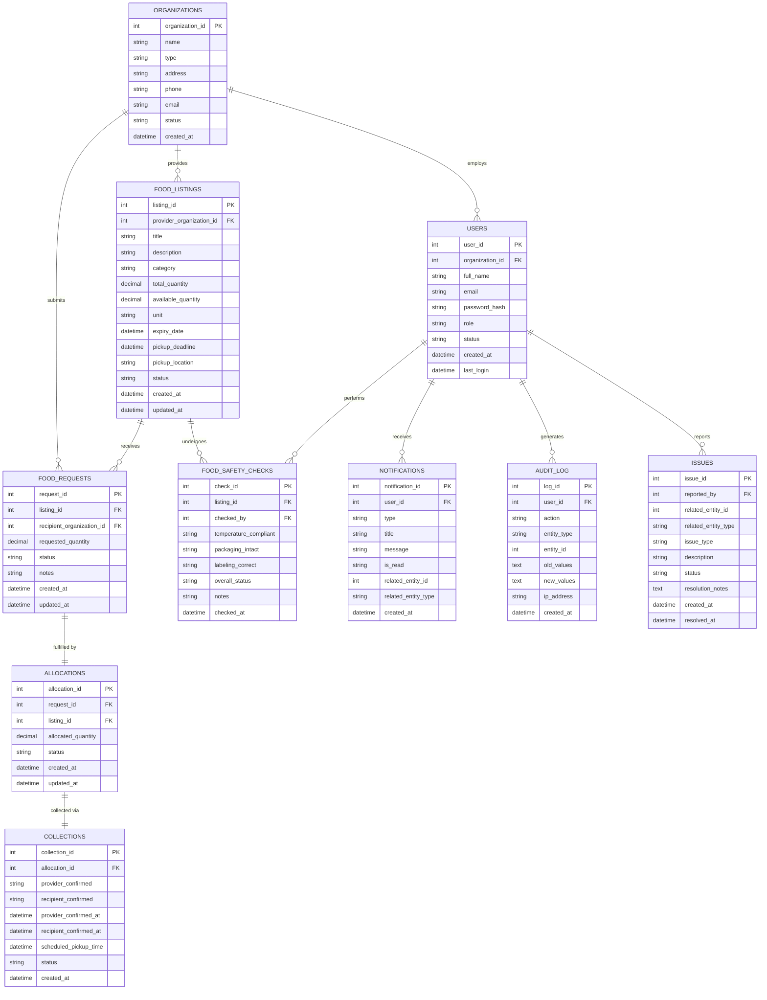

# FoodBridge — Database Design Document

## 1. Overview

FoodBridge uses **MySQL 8.0** as its primary relational database, storing all transactional, user, and operational data. **MongoDB** acts as a supplementary document store for analytics aggregations and extended metadata. The schema is designed around **strict normalization (3NF)**, **referential integrity** via foreign keys, and **ACID-compliant transactions** for the critical allocation workflow.

---

## 2. Entity–Relationship Diagram



---

## 3. Table Descriptions

### 3.1 `organizations`
The central entity representing food **providers** (restaurants, supermarkets, farms) and **recipients** (food banks, shelters, NGOs).

| Column | Type | Constraints | Purpose |
|--------|------|-------------|---------|
| `organization_id` | INT | PK, AUTO_INCREMENT | Unique org identifier |
| `name` | VARCHAR(200) | NOT NULL | Organization display name |
| `type` | ENUM | NOT NULL | `PROVIDER` \| `RECIPIENT` |
| `address` | TEXT | NOT NULL | Physical address for pickup/delivery |
| `phone` | VARCHAR(20) | — | Contact phone |
| `email` | VARCHAR(150) | UNIQUE | Organization-level contact |
| `status` | ENUM | DEFAULT 'PENDING' | `PENDING` \| `VERIFIED` \| `SUSPENDED` |
| `created_at` | DATETIME | DEFAULT NOW() | Registration timestamp |

> **Design note**: Organizations can only exist as one type. A single entity cannot be both a provider and a recipient simultaneously, ensuring unambiguous role assignment in the allocation workflow.

---

### 3.2 `users`
Individual accounts that belong to an organization. A user inherits the operational role of their organization but may have system-level roles like `ADMIN`.

| Column | Type | Constraints | Purpose |
|--------|------|-------------|---------|
| `user_id` | INT | PK, AUTO_INCREMENT | Unique user identifier |
| `organization_id` | INT | FK → organizations | The org this user belongs to |
| `full_name` | VARCHAR(150) | NOT NULL | Display name |
| `email` | VARCHAR(150) | UNIQUE, NOT NULL | Login credential and notification target |
| `password_hash` | VARCHAR(255) | NOT NULL | BCrypt-hashed password |
| `role` | ENUM | NOT NULL | `PROVIDER` \| `RECIPIENT` \| `ADMIN` |
| `status` | ENUM | DEFAULT 'ACTIVE' | `ACTIVE` \| `SUSPENDED` \| `PENDING` |
| `last_login` | DATETIME | — | Updated on each successful login |

---

### 3.3 `food_listings`
Represents a single batch of food available for redistribution, posted by a provider organization.

| Column | Type | Constraints | Purpose |
|--------|------|-------------|---------|
| `listing_id` | INT | PK, AUTO_INCREMENT | Unique listing identifier |
| `provider_organization_id` | INT | FK → organizations | Who is donating this food |
| `title` | VARCHAR(200) | NOT NULL | Short descriptive title |
| `category` | VARCHAR(100) | NOT NULL | Food category (Produce, Dairy, etc.) |
| `total_quantity` | DECIMAL(10,2) | NOT NULL | Original total amount offered |
| `available_quantity` | DECIMAL(10,2) | NOT NULL | Remaining unallocated quantity |
| `unit` | VARCHAR(50) | NOT NULL | Measurement unit (kg, boxes, meals) |
| `expiry_date` | DATETIME | NOT NULL | When food expires (safety deadline) |
| `pickup_deadline` | DATETIME | NOT NULL | When pickup must happen |
| `pickup_location` | TEXT | NOT NULL | Address/directions for collection |
| `status` | ENUM | DEFAULT 'ACTIVE' | `ACTIVE` \| `PARTIALLY_ALLOCATED` \| `FULLY_ALLOCATED` \| `EXPIRED` \| `CANCELLED` |

> **Design note**: `available_quantity` is stored separately from `total_quantity` because it changes with every allocation approval. Recalculating it by summing allocations on every read would be expensive and introduce race-condition risks. The separation allows atomic `UPDATE ... WHERE available_quantity >= requested_quantity` checks.

---

### 3.4 `food_requests`
A recipient organization's formal request for a portion of a specific listing.

| Column | Type | Constraints | Purpose |
|--------|------|-------------|---------|
| `request_id` | INT | PK, AUTO_INCREMENT | Unique request identifier |
| `listing_id` | INT | FK → food_listings | The listing being requested |
| `recipient_organization_id` | INT | FK → organizations | Who is requesting |
| `requested_quantity` | DECIMAL(10,2) | NOT NULL | How much they want |
| `status` | ENUM | DEFAULT 'PENDING' | `PENDING` \| `APPROVED` \| `REJECTED` \| `CANCELLED` \| `FULFILLED` |
| `notes` | TEXT | — | Optional message to provider |

---

### 3.5 `allocations`
Created when a provider **approves** a food request. The allocation bridges a request to the confirmed quantity transfer.

| Column | Type | Constraints | Purpose |
|--------|------|-------------|---------|
| `allocation_id` | INT | PK, AUTO_INCREMENT | Unique allocation identifier |
| `request_id` | INT | FK → food_requests, UNIQUE | One-to-one with request |
| `listing_id` | INT | FK → food_listings | Redundant FK for fast joins |
| `allocated_quantity` | DECIMAL(10,2) | NOT NULL | Actual quantity approved (may differ from requested) |
| `status` | ENUM | DEFAULT 'PENDING' | `PENDING` \| `CONFIRMED` \| `COMPLETED` \| `CANCELLED` |

> **Why a separate allocations table?** The `food_requests` table records *intent*; the `allocations` table records *commitment*. Keeping them separate allows a provider to approve a different quantity than requested, maintains a clear audit trail, and enables the collection workflow to reference a confirmed allocation independently.

---

### 3.6 `collections`
Tracks the physical pickup event. Both provider and recipient must confirm the handoff, creating a two-party verification record.

| Column | Type | Constraints | Purpose |
|--------|------|-------------|---------|
| `collection_id` | INT | PK, AUTO_INCREMENT | Unique collection identifier |
| `allocation_id` | INT | FK → allocations, UNIQUE | One-to-one with allocation |
| `provider_confirmed` | TINYINT(1) | DEFAULT 0 | Provider has marked as handed over |
| `recipient_confirmed` | TINYINT(1) | DEFAULT 0 | Recipient has marked as received |
| `provider_confirmed_at` | DATETIME | — | Timestamp of provider confirmation |
| `recipient_confirmed_at` | DATETIME | — | Timestamp of recipient confirmation |
| `scheduled_pickup_time` | DATETIME | — | Agreed pickup window |
| `status` | ENUM | DEFAULT 'SCHEDULED' | `SCHEDULED` \| `COMPLETED` \| `FAILED` |

---

### 3.7 `food_safety_checks`
Optional quality-control record attached to a listing. An authorized user (ADMIN or PROVIDER) records whether safety criteria are met.

| Column | Type | Constraints | Purpose |
|--------|------|-------------|---------|
| `check_id` | INT | PK | Unique check identifier |
| `listing_id` | INT | FK → food_listings | Which listing was inspected |
| `checked_by` | INT | FK → users | Inspector's user ID |
| `temperature_compliant` | TINYINT(1) | — | Cold chain intact |
| `packaging_intact` | TINYINT(1) | — | No damaged packaging |
| `labeling_correct` | TINYINT(1) | — | Proper labels present |
| `overall_status` | ENUM | — | `PASS` \| `FAIL` \| `CONDITIONAL` |

---

### 3.8 `notifications`
In-app notifications generated by business events (new request, allocation approved, collection confirmed, etc.).

| Column | Type | Purpose |
|--------|------|---------|
| `notification_id` | INT PK | Unique identifier |
| `user_id` | INT FK | Target user |
| `type` | VARCHAR | Event type code (e.g., `ALLOCATION_APPROVED`) |
| `title` | VARCHAR | Short notification heading |
| `message` | TEXT | Full notification body |
| `is_read` | TINYINT(1) | Read/unread flag |
| `related_entity_id` | INT | ID of the related business object |
| `related_entity_type` | VARCHAR | Type of related object (LISTING, ALLOCATION, etc.) |

---

### 3.9 `audit_log`
Immutable log of all state-changing actions performed in the system. Written by Spring AOP advice on service methods and never deleted.

| Column | Type | Purpose |
|--------|------|---------|
| `log_id` | INT PK | Unique log entry |
| `user_id` | INT FK | Who performed the action |
| `action` | VARCHAR | Action code (e.g., `APPROVE_ALLOCATION`) |
| `entity_type` | VARCHAR | Affected entity type |
| `entity_id` | INT | ID of the affected record |
| `old_values` | JSON | State before change |
| `new_values` | JSON | State after change |
| `ip_address` | VARCHAR | Client IP (for security audits) |

---

### 3.10 `issues`
Allows any authenticated user to report a problem related to a listing, allocation, or collection (e.g., food was not as described).

| Column | Type | Purpose |
|--------|------|---------|
| `issue_id` | INT PK | Unique issue identifier |
| `reported_by` | INT FK → users | Who filed the report |
| `related_entity_id` | INT | The problematic entity's ID |
| `related_entity_type` | VARCHAR | Entity type (LISTING, COLLECTION, etc.) |
| `issue_type` | VARCHAR | Category (QUALITY, SAFETY, NO_SHOW, etc.) |
| `description` | TEXT | Detailed description |
| `status` | ENUM | `OPEN` \| `INVESTIGATING` \| `RESOLVED` \| `CLOSED` |
| `resolution_notes` | TEXT | Admin's resolution remarks |

---

## 4. Normalization Analysis

### 4.1 First Normal Form (1NF)
All tables satisfy 1NF because:
- Every column holds **atomic values** (no comma-separated lists, no repeating groups).
- Every row is **uniquely identifiable** by its primary key.
- Example: Food categories are stored as a single VARCHAR per listing, not as a multi-value set.

### 4.2 Second Normal Form (2NF)
All tables use **single-column surrogate primary keys** (auto-increment integers), so no partial dependency on a composite key can exist. Every non-key attribute in every table depends on the **whole** primary key.

Example — `food_listings`:
- `title`, `category`, `available_quantity` all depend solely on `listing_id`.
- Provider details (name, address) are NOT stored here — they are looked up via `provider_organization_id` → `organizations`.

### 4.3 Third Normal Form (3NF)
No transitive dependencies exist. Each non-key column depends only on the primary key, not on another non-key column.

Example — `food_requests`:
- The recipient's name and address are NOT stored in `food_requests`; only `recipient_organization_id` is stored, and the full data is retrieved from `organizations`.
- This prevents update anomalies: if an organization changes its address, only one row in `organizations` must be updated.

Example — `allocations`:
- The `listing_id` FK in `allocations` appears redundant (it could be derived via `request_id → food_requests.listing_id`), but it is included for **query performance** (avoiding an extra join in the hot allocation approval path). This is a deliberate, documented denormalization for performance, not a 3NF violation.

---

## 5. Key Design Decisions

### 5.1 Transaction-Safe Allocation
The critical risk in a food redistribution system is **double allocation** — two concurrent requests both succeeding against the same limited quantity. The system prevents this using a conditional `UPDATE` inside a transaction:

```sql
-- Step 1: Atomically reduce available quantity (fails if insufficient)
UPDATE food_listings
SET available_quantity = available_quantity - ?
WHERE listing_id = ? AND available_quantity >= ?;

-- Step 2: Only proceed if the UPDATE affected 1 row
-- If rowsAffected == 0, throw InsufficientQuantityException and ROLLBACK
```

This pattern is called **optimistic concurrency control via conditional update**. Because MySQL's InnoDB engine applies a row-level lock during `UPDATE`, two simultaneous approval attempts will serialize naturally — one will succeed, the other will find `available_quantity` now insufficient and fail cleanly.

### 5.2 `available_quantity` vs `total_quantity`
| Attribute | Purpose |
|-----------|---------|
| `total_quantity` | Immutable record of what was originally offered; used in analytics and audit |
| `available_quantity` | Changes with each allocation; used in availability checks and listing status transitions |

Storing them separately avoids scanning the `allocations` table on every availability check.

### 5.3 Separate `allocations` Table
Although the approval outcome could be stored as a status column in `food_requests`, a separate `allocations` table provides:
1. **Different cardinality**: A request is always 1:1 with an allocation, enforced by `UNIQUE(request_id)`.
2. **Independent lifecycle**: An allocation can be cancelled without deleting the original request (preserving history).
3. **Clear responsibility boundary**: Requests = intent. Allocations = commitment. Collections = execution.

### 5.4 MySQL vs MongoDB Responsibilities
| Concern | MySQL | MongoDB |
|---------|-------|---------|
| Transactional data (listings, requests, allocations) | ✅ | ❌ |
| Referential integrity | ✅ (FK constraints) | ❌ |
| User accounts and auth | ✅ | ❌ |
| Complex analytics aggregations | ❌ (acceptable for small scale) | ✅ |
| Flexible metadata / extended attributes | ❌ | ✅ |
| Audit snapshots with nested JSON | Limited | ✅ |

---

## 6. Indexes

| Index Name | Table | Columns | Optimizes Query |
|-----------|-------|---------|----------------|
| `idx_listings_status` | `food_listings` | `status` | Browse active listings (most common query) |
| `idx_listings_category` | `food_listings` | `category` | Filter listings by food category |
| `idx_listings_expiry` | `food_listings` | `expiry_date` | Expire old listings via scheduled job |
| `idx_listings_provider` | `food_listings` | `provider_organization_id` | Provider's own listing dashboard |
| `idx_requests_listing` | `food_requests` | `listing_id` | Show all requests on a listing |
| `idx_requests_recipient` | `food_requests` | `recipient_organization_id` | Recipient's request history |
| `idx_requests_status` | `food_requests` | `status` | Filter pending/approved requests |
| `idx_allocations_listing` | `allocations` | `listing_id` | Aggregate allocated quantity per listing |
| `idx_allocations_status` | `allocations` | `status` | Operational allocation dashboards |
| `idx_notifications_user_read` | `notifications` | `(user_id, is_read)` | Unread count badge (called on every page load) |
| `idx_audit_user` | `audit_log` | `user_id` | Admin: view actions by a specific user |
| `idx_audit_entity` | `audit_log` | `(entity_type, entity_id)` | Admin: full history of one entity |
| `idx_users_email` | `users` | `email` | Login lookup (most critical path) |
| `idx_users_org` | `users` | `organization_id` | Look up all users in an org |

---

## 7. Allocation Transaction Flow

The allocation approval is the most complex database operation and runs inside a single JDBC transaction (`TransactionTemplate`):

```
BEGIN TRANSACTION (InnoDB)
│
├─ [1] SELECT food_requests WHERE request_id = ? AND status = 'PENDING'
│         → Fetch the request; fail if not found or not PENDING
│
├─ [2] UPDATE food_listings
│       SET available_quantity = available_quantity - :requestedQty,
│           status = CASE WHEN available_quantity - :requestedQty <= 0
│                         THEN 'FULLY_ALLOCATED' ELSE 'PARTIALLY_ALLOCATED' END
│       WHERE listing_id = ? AND available_quantity >= :requestedQty
│         → Fail (ROLLBACK) if rowsAffected == 0  (insufficient quantity)
│
├─ [3] UPDATE food_requests SET status = 'APPROVED' WHERE request_id = ?
│
├─ [4] INSERT INTO allocations (request_id, listing_id, allocated_quantity, status)
│       VALUES (?, ?, ?, 'PENDING')
│
├─ [5] INSERT INTO collections (allocation_id, status) VALUES (?, 'SCHEDULED')
│
├─ [6] INSERT INTO notifications (user_id, type, message, ...)
│       VALUES (recipientUserId, 'ALLOCATION_APPROVED', ...)
│
└─ COMMIT
```

If any step fails, the entire transaction rolls back, leaving the database in a consistent state.

---

## 8. Views

| View Name | Definition | Purpose |
|-----------|-----------|---------|
| `v_active_listings` | SELECT from `food_listings` WHERE `status = 'ACTIVE' AND expiry_date > NOW()` | Simplifies all public listing queries |
| `v_pending_requests` | JOIN `food_requests` + `food_listings` + `organizations` WHERE `requests.status = 'PENDING'` | Provider dashboard: see all pending requests with context |
| `v_allocation_summary` | JOIN `allocations` + `food_requests` + `collections` + `organizations` | Admin overview of all allocations and their collection state |

---

## 9. Triggers

| Trigger Name | Event | Action |
|-------------|-------|--------|
| `trg_listing_status_update` | AFTER UPDATE on `food_listings` | Automatically sets `status = 'EXPIRED'` when `expiry_date < NOW()` during batch updates |
| `trg_collection_complete` | AFTER UPDATE on `collections` | When both `provider_confirmed = 1` AND `recipient_confirmed = 1`, sets `status = 'COMPLETED'` and updates parent `allocations.status = 'COMPLETED'` |
| `trg_audit_user_status` | AFTER UPDATE on `users` | Writes to `audit_log` whenever a user's `status` changes (suspension/reinstatement) |

---

## 10. Stored Procedures

| Procedure | Parameters | Purpose |
|-----------|-----------|---------|
| `sp_expire_listings` | `cutoff_datetime` | Bulk-updates all listings past `pickup_deadline` to `EXPIRED`; called by scheduled job |
| `sp_provider_stats` | `org_id`, `start_date`, `end_date` | Returns donation totals, unique recipients, and food-saved weight for a provider in one call |
| `sp_platform_summary` | — | Aggregates platform-wide KPIs (total listings, total allocations, total kg saved) for the admin dashboard |

---

## 11. Data Integrity Constraints Summary

| Constraint | Location | Enforcement |
|-----------|----------|-------------|
| One allocation per request | `allocations.request_id UNIQUE` | DB-level |
| One collection per allocation | `collections.allocation_id UNIQUE` | DB-level |
| Email uniqueness | `users.email UNIQUE` | DB-level |
| Quantity non-negative | `CHECK (available_quantity >= 0)` | DB-level |
| Valid status transitions | Enum types + service layer | Application-level |
| Referential integrity | FK constraints with InnoDB | DB-level |
| Password hashing | BCryptPasswordEncoder in `UserService` | Application-level |
